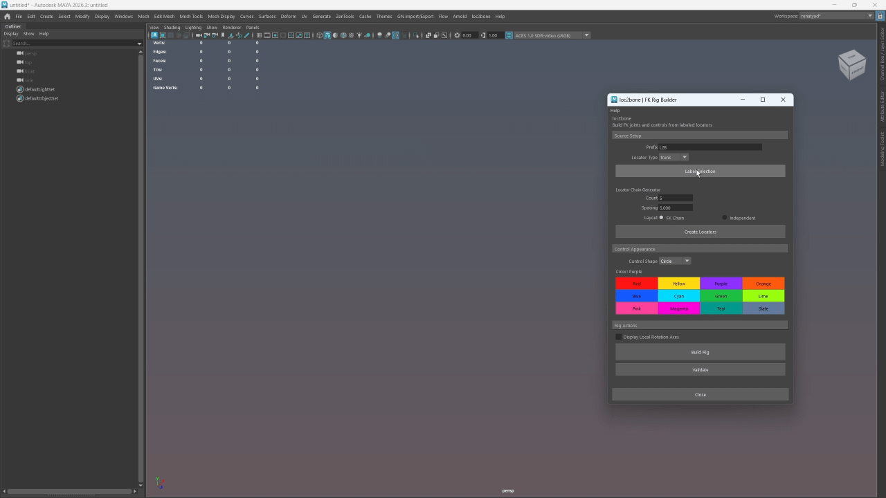

# loc2bone

**Version 0.0.1**

Build an FK joint-and-control rig from a labeled locator hierarchy in Maya.

**Maya 2022–2026** · **Python only** · **No third-party dependencies**



## Install

1. Download `loc2bone.py`.
2. Drag the file into a Maya viewport.
3. Click the new **loc2bone** button on the active shelf.

Dropping a newer copy updates the script and the existing shelf button.

### Script Editor

Copy `loc2bone.py` to your Maya scripts folder, then run:

```python
import loc2bone
loc2bone.run()
```

### Plug-in Manager

`loc2bone.py` can also be loaded as a Python plug-in. This registers the `loc2bone` command and adds a Maya main-menu entry.

## Quick workflow

1. Open **loc2bone** from the shelf.
2. Create a locator chain or arrange existing locators.
3. Choose a prefix and locator type, then use **Label Selection** if needed.
4. Pick control shape, color, and optional local rotation axes.
5. Click **Validate**, then **Build Rig**.

## Plant use case

loc2bone was made for quick organic FK setups that are too repetitive to build by hand. For a plant with a trunk, many flower stems, and leaves, place locators through the structure, parent them into the intended shape, then build one control hierarchy. The result is a clean set of controls for bending the trunk, posing stems, and adding secondary motion without manually creating every joint, offset group, and constraint.

## Locator names

Source locators must use this format:

```text
PREFIX_type_number
```

Supported types are:

```text
trunk
brunch
leaf
```

Examples:

```text
Tree_trunk_001
Tree_brunch_001
Tree_leaf_001
```

The nearest labeled locator ancestor defines the generated FK parent. Regular transform groups may sit between labeled locators for scene organization; an unlabeled locator in that path is invalid and stops validation/build.

## Generated hierarchy

```text
PREFIX_rig_gr
├── PREFIX_jnt_gr
│   └── PREFIX_type_001_jnt_gr
│       └── PREFIX_type_001_jnt
└── PREFIX_ctrl_gr
    └── PREFIX_type_001_ctrl_gr
        └── PREFIX_type_001_ctrl
```

Controls have zeroed translate and rotate channels. Placement lives on their `_gr` groups. Joints follow their matching controls through parent and scale constraints.

## Options

- **Locator Chain Generator** creates either a serial FK chain or independent root locators along world X.
- **Control Shape** provides Circle, Triangle, Square, and Star controls.
- **Control Color** provides twelve viewport colors for newly built controls.
- **Display Local Rotation Axes** enables local axes on newly created controls only.
- **Undo** removes a locator-generation or rig-build operation in one step.

## Notes

- Build Rig stops if `PREFIX_rig_gr` already exists. Remove the old rig or use another prefix.
- Source locators are kept in the scene; the tool does not delete or alter them after a successful build.
- The tool is intended for simple FK structures. It does not provide a rebuild or rig-update command.

See the [User Guide](docs/USER_GUIDE.md), [demo capture list](docs/DEMO_SHOT_LIST.md), and [changelog](CHANGELOG.md).

## License

[MIT](LICENSE) © Renat Yad, 2026.
